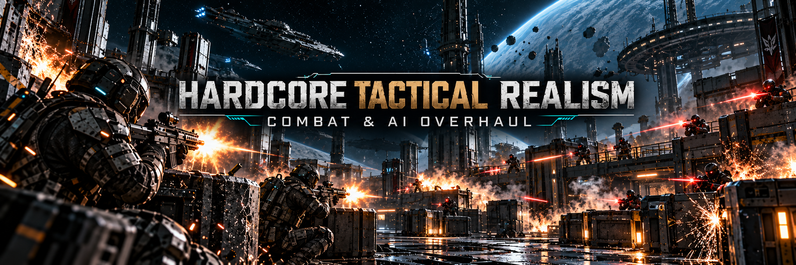

# Hardcore Tactical Realism (HTR) — Combat & AI Overhaul for SpaceBourne 2

On-foot combat in SpaceBourne 2 is an MMO bullet-sponge: a level 30 raider soaks up
15 000 HP plus 15 000 armor, your damage depends on weapon level, and headshots barely
matter. **HTR replaces that with ballistics**: what kills is the round, where it hits and
what armor it hits. Enemies go down fast, fight smarter, bleed, break bones and throw
grenades — and so can you. Fight from cover.

Inspired by Cyberpunk 2077 *Hardcore Realism*, Fallout: New Vegas *Realistic Combat
Overhaul* and *NPC AI Improvement* (no code from those mods is used). Works together with
my [SB2 HOTAS](https://github.com/hubertdungen/SpaceBourne2-HOTAS) mod.

**Links:** [GitHub](https://github.com/hubertdungen/SpaceBourne2-HardcoreTacticalRealism) ·
[Nexus Mods](https://www.nexusmods.com/games/spacebourne2/mods/4) ·
[Steam discussion](https://steamcommunity.com/app/1646850/discussions/0/573805072991123580/) ·
[SB2 HOTAS](https://github.com/hubertdungen/SpaceBourne2-HOTAS).
More realism mods for SpaceBourne 2 are in the works (engineering turrets, tactical first
person, stealth, gear at any level, faction power, split ship/foot invert); they will be
linked here as they come out.

## Install (2 minutes)

HTR is a Lua mod for **UE4SS** (the script loader most SpaceBourne 2 mods use). Pick one:

**A. One-click installer (recommended, includes UE4SS)**
1. Download `HardcoreTacticalRealism-x.y.z.zip` (the big one) from
   [GitHub Releases](https://github.com/hubertdungen/SpaceBourne2-HardcoreTacticalRealism/releases/latest).
2. Extract it anywhere (e.g. Downloads) and double-click **`Install.cmd`**.
   - Steam: found automatically.
   - GOG / other folder: drag your `SpaceBourne 2` folder onto `Install.cmd`.
3. Start the game. Done.

**B. Lua-only file (Nexus, or `-lite.zip` on GitHub) — if you already have UE4SS**
(for example from SB2 HOTAS):
1. Open your game folder (`...\SpaceBourne 2`, the one with `SpaceBourne2.exe`).
2. Extract the zip **there**. It creates `SB2\Binaries\Win64\Mods\HardcoreTacticalRealism`
   and switches itself on — nothing else to edit.
3. No UE4SS yet? Get [RE-UE4SS 3.0.1](https://github.com/UE4SS-RE/RE-UE4SS/releases/tag/v3.0.1)
   and copy `dwmapi.dll`, `UE4SS.dll` and `UE4SS-settings.ini` into
   `SpaceBourne 2\SB2\Binaries\Win64\` — or simply use option A.

**Update:** install the new version the same way (the installer keeps your `config.lua`).
**Uninstall:** `Uninstall.cmd` (option A) or delete the `HardcoreTacticalRealism` folder
(option B). HTR never writes to your saves, so you can add or remove it at any time.

## Controls

| Key | What it does |
|---|---|
| **F7** | Next mode: Tactical → Tactical Hardcore → Realism → Realism Hardcore (shown on the HUD) |
| **Ctrl+Insert** | Gear bonus on/off (off by default; see below). Was F8 before 0.4.3, which is also the game's quick load |
| **F9** | Ships vs infantry on/off (shown on the HUD) |
| **F11** | Slow perks on/off (on by default; see below) |
| Gamepad (experimental) | press **Switch camera** 4 times quickly = next mode; crouched = ships toggle |

All choices are remembered between sessions. Keys can be changed in `config.lua`.

## Perks (F11 — slow by default)

With realistic damage, perks such as the turret, barricade, ground slam, shield or slow time
turn into super powers. HTR makes the suit's perk energy refill **4x slower on foot** and the
turret / barricade / ground-slam / auto-revive cooldowns run 4x slower, so a perk is a tactical
tool you save for the right moment. Ship energy is not affected. F11 switches back to vanilla.

## Modes

| Mode | Damage you and your allies take | Wounds on your side |
|---|---|---|
| **Tactical** (default) | follows weapon and hit zone, always **100–150 %** of vanilla | rare |
| **Tactical Hardcore** | Tactical, then **all damage x2** (both sides) | occasional |
| **Realism** | **exactly the same rules as enemies**; your suit is your armor | full |
| **Realism Hardcore** | Realism, then **all damage x2** (both sides) | full, bleeding x2 |

Enemies always use the realistic model.

## Damage model

- Damage = **caliber vs armor + hit zone**. NPC level, weapon level and rarity no longer matter
  (unless you switch on the small optional gear bonus, Ctrl+Insert).
- Unarmored targets drop in **1–2 rifle hits**, heavy armor in **5–6**, power armor and
  robots in **6–8**. Snipers kill almost anything in one hit; melee kills in one or two blows.
- **Headshots** kill a bare head with any firearm, and **no helmet stops a headshot
  completely** (at least 40 % always gets through): 1–2 headshots kill through any helmet.
  This applies to everyone — NPCs shooting NPCs included (vanilla has no NPC headshots).
- Armor **wears down** as it stops rounds (the armor bar shows its condition); worn armor
  protects less. Vanilla's armor-overflow bug is gone.
- Destroyed limbs use the game's own dismemberment; lethal hits blow off the part that was
  hit (needs *Gore* on in Gameplay settings).

| Hits to kill (centre mass / head) | none | light | medium | heavy | power |
|---|---|---|---|---|---|
| Pistol | 2 / 1 | 4 / 1 | 6 / 2 | 7 / 2 | 8 / 2 |
| SMG | 2 / 1 | 4 / 1 | 6 / 2 | 8 / 2 | 8 / 2 |
| Rifle | 2 / 1 | 3 / 1 | 4 / 1 | 5 / 2 | 6 / 2 |
| Hunter (DMR) | 2 / 1 | 2 / 1 | 2 / 1 | 3 / 1 | 3 / 1 |
| Sniper | 1 / 1 | 1 / 1 | 1 / 1 | 1 / 1 | 2 / 1 |
| Knife / Sword / Hammer | 1 | 1 | 2 / 1 / 1 | 2 / 2 / 1 | 3 / 2 / 2 |

Shotgun pellets count individually (one close blast kills an unarmored target). Bosses have
a tougher body (about 8–9 rifle hits, 3 to the head). Ground turrets (team battles, bases) are
heavy emplaced guns: one round every 1.5 s, one hit kills an unarmored target, two kill through
any armor.

## Gear bonus (optional, Ctrl+Insert — off by default)

For players who still like a bit of RPG feel. With the gear bonus on, weapon and armor **level**
(and item rarity) add a **small extra** on top of the ballistics — they never decide whether a
weapon works. A level 5 rifle still drops a level 60 raider in a few hits; a level 60 rifle just
needs one hit fewer.

- **Weapon:** up to +8 penetration points and +15 % damage.
- **Armor:** up to +8 protection points and 25 % less wear (only where there is armor).
- **Scale:** diminishing returns — level 1 gives nothing, level 10 gives 56 % of the bonus,
  level 30 gives 83 %, level 60 the full bonus. Each rarity step above common counts as 5 levels.
- **Whose level:** your weapon item and your level for your suit; NPCs and turrets their own
  level; squad soldiers your level. It works the same for both sides, so it also fits the
  Realism modes (you can switch it off per mode in `config.lua`). In the Tactical modes the damage
  you and your allies take stays at 100–150 % of vanilla, so there the bonus mostly changes the
  damage your side deals.

| Rifle vs heavy armor, hits to kill | armor L1 | armor L10 | armor L30 | armor L60 |
|---|---|---|---|---|
| Rifle L1 | 5 | 6 | 6 | 6 |
| Rifle L10 | 4 | 5 | 5 | 5 |
| Rifle L30 | 4 | 4 | 5 | 5 |
| Rifle L60 | 4 | 4 | 4 | 5 |

Gear bonus off (the default) = the tables above, for every level.

## Wounds and healing

- **Bleeding:** a round that gets through the armor can open a wound that drains HP for
  15–25 s until the suit's nanites clot it (up to 3 wounds at once). Bleeding stops healing.
- **Broken bones:** a heavy hit to an arm or leg can break it. NPCs with a broken arm aim
  badly; for you, healing is halved until the nanites fuse the bone (about a minute).
- **Robots** never bleed, but a heavy hit can still wreck an arm (shaky aim) or a leg.
- **Squad soldiers** bleed too; once they go down, the game's own bleed-out timer takes over
  and a medic (or you) can still bring them back.
- Enemies get wounded in every mode. You and your allies get wounded rarely in Tactical,
  more in Tactical Hardcore, and fully in Realism; Hardcore modes bleed twice as fast.
- **Healing:** your suit's own healing is kept but slowed by mode — Tactical 70 %, Tactical
  Hardcore 50 %, Realism 25 %, Realism Hardcore 12 % of vanilla — and it starts 8–15 s after
  your last hit. Armor nanites slowly repair the suit too.

## Explosions, grenades and ships

- **Explosions** (your grenades, NPC grenades, rockets) do realistic damage that fades with
  distance and gibs at close range. In vanilla, NPCs ignore every explosion that isn't yours.
- **NPC grenades:** regular and elite troops throw grenades when you hide behind cover too long.
- **Ships vs infantry (F9):** ship guns — yours and AI ships' — now hit people on foot. A direct
  hit kills almost anyone and the blast hurts everyone nearby, friends included.

## Friendly fire

| Attacker → victim | Tactical modes | Realism modes |
|---|---|---|
| You → companions / squad | 35 % | 100 % |
| Companions / squad → you | 35 % | 100 % |
| Ally → ally, allied turrets | vanilla, max 10 % HP per hit | same |
| Enemy → enemy, ally ↔ enemy | 100 % (realistic) | same |

Ground turrets fight for their own team. Your squad soldiers now take realistic damage too:
in the Tactical modes they go down injured first (as vanilla); in the Realism modes headshots
and heavy overkill kill outright and other lethal hits almost always do (80 % / 95 %), so both
sides follow the same lethal rules. They wear at least medium armor and a helmet, so they
can hold a firefight instead of dropping as soon as they show up.

## AI and doctrines

- NPC bullets fly at 360–500 m/s instead of 100 m/s, but NPCs aim like people: spread by
  training, a settle-in time after spotting you, worse aim while moving, hurt or suppressed,
  and centre-mass aim instead of vanilla's random feet/above-the-head points.
- Vanilla behaviour that never triggered now works: breaking line of sight when hit, falling
  back when badly hurt, calling allies, peeking from cover every 2.5 s instead of 5 s.
- **NPCs keep fighting:** an NPC that dives for cover fights from there for a few seconds
  before your fire can send it running again (no more enemies that only run under fire), and it
  resumes firing as soon as it aims at you again.
- **Your squad keeps up:** vanilla squad soldiers walk, fall behind and then teleport next to
  you. HTR makes them run and sprint after you, so only a stuck soldier still teleports.
- **Suppression:** your rounds landing close make enemies duck and shoot worse.
- **Situational awareness:** relaxed enemies (no fight yet) only notice you up close; once
  alert (they spotted you, got hit or were warned) they spot and shoot much farther.
- **Arrival grace:** after an elevator ride, a new dungeon floor or a level load, and for
  freshly spawned NPCs, everyone (enemies and allies) aims very badly for 3-4 s, so nobody
  gets massacred the moment a floor loads.
- Companions' bullets work (vanilla gave them a 0-second projectile life).

| Doctrine | Who | How they fight |
|---|---|---|
| Pirate | raiders, salvagers | slow, spray, wide spread, may panic when mates die or flee when badly hurt |
| Militia | low-tier troops | better than pirates, still sloppy |
| Regular | standard faction troops | quick, accurate, cover, grenades |
| Elite | high-tier troops, guards, bosses | fastest reactions, tight aim, grenades, alert the area |
| Machine | robots | fearless, steady, never retreat |
| Companion | your allies | elite-level aim, no panic |

## Settings

`SB2\Binaries\Win64\Mods\HardcoreTacticalRealism\scripts\config.lua` (open with Notepad,
restart the game after saving): mode and keys, every feature on/off, Hardcore multiplier,
helmet rule, wounds and healing per mode, gear bonus strength, ships vs infantry strength,
perk speed, enemy awareness ranges, squad pace, friendly fire, boss toughness, logging. Deeper tuning: `htr\ballistics.lua` (calibers, armor, hit zones)
and `htr\doctrines.lua` (how each kind of NPC fights).

## Known limitations

- On-foot combat only; ship-vs-ship combat is unchanged.
- The game has no faction field on soldiers, so doctrines use its raider flag, troop tier,
  guard/robot/boss flags and companion status.
- Gamepad toggles are experimental (untested without a controller).
- Tested on the Steam build of 26 Oct 2026. Bug reports with `htr.log` (set `Debug.Log = true`)
  are very welcome; if you ever notice stutter, `htr.log` names any HTR code that took longer
  than 8 ms.
- **Versions before 0.3.2 froze the game for a moment on every shot** — fixed in 0.3.2; please update.
  In-game tests while firing now show the same frame times as the game without mods.

## After a game update

Every game-internal name lives in one file, `htr\gamedefs.lua`. If an update renames
something, HTR switches that feature off (logged in `UE4SS.log`) instead of crashing.
`tools\` holds the scripts used to inspect the game's Blueprints.

## Credits & license

MIT licensed — see `LICENSE`. Uses [UE4SS](https://github.com/UE4SS-RE/RE-UE4SS) (MIT).
Code written with AI assistance; banner images are AI-generated. Unofficial fan mod, not
affiliated with the developer of SpaceBourne 2.
